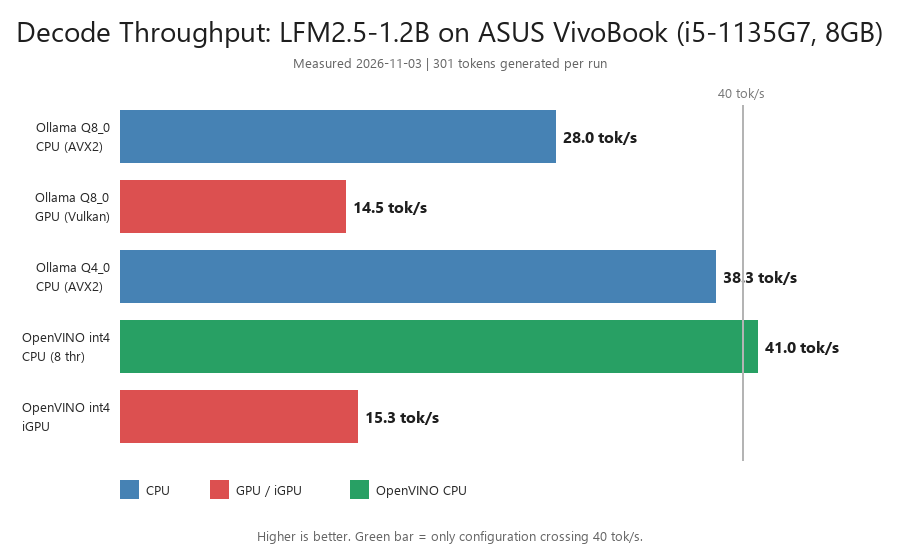
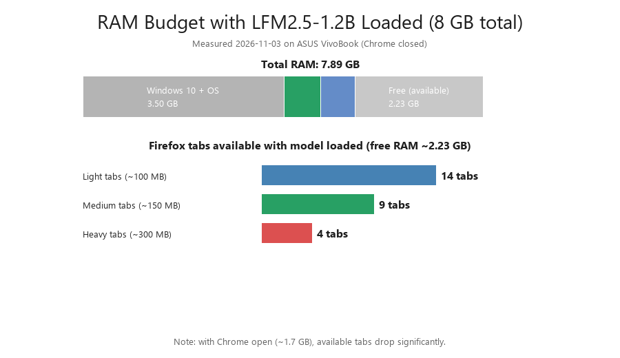

# Edge LLM Inference Benchmark: LFM2.5-1.2B on a 2021 Consumer Laptop

> **Measured, not estimated.** Real throughput numbers for a 1.2B-parameter LLM running locally on an 8 GB, 2021-era laptop (Intel i5-1135G7, Iris Xe, Windows 10). No cloud, no dedicated GPU, no server.



## TL;DR

| Finding | Value |
|---|---|
| Best decode throughput | **40.9 tok/s** (OpenVINO int4, CPU, 8 threads) |
| Claimed range (40–70 tok/s) | **Partially confirmed** — only OpenVINO int4 on CPU crosses 40 |
| CPU vs integrated GPU | **CPU wins 2×** (40.9 vs 15.3 tok/s) |
| Model footprint (int4) | **0.64 GB** |
| Free RAM with model loaded | **2.23 GB** → ~9–14 Firefox tabs |
| Conversion feasibility | **Local conversion crashes** (access violation); pre-converted model works |

## Hardware under test

| Component | Specification |
|---|---|
| Laptop | ASUS VivoBook (2021) |
| CPU | Intel Core i5-1135G7 — 4 cores / 8 threads, Tiger Lake, 2.4 GHz base |
| GPU | Intel Iris Xe Graphics — 80 EUs, integrated, shared memory |
| RAM | 8 GB DDR4 (7.89 GB usable) |
| OS | Windows 10 Home 19045 (22H2) |
| Vulkan | 1.2.198, Intel proprietary driver 30.0.101.1404, conformance 1.2.6.1 |

## Model

**LiquidAI LFM2.5-1.2B-Instruct** — hybrid architecture (short-range convolutions + attention), 1.2B parameters, designed for on-device deployment. Tested in three quantizations:

- **Q8_0** (1.19 GB) — via Ollama (imported from GGUF)
- **Q4_0 / QAD** (0.66 GB) — via Ollama (imported from GGUF)
- **int4 group-quantized** (0.64 GB) — via OpenVINO (pre-converted from `OpenVINO/LFM2.5-1.2B-Instruct-int4-gq-ov`, group_size 128, NNCF, INT4_SYM)

## Results

### Decode throughput (tokens/sec, 301 tokens generated per run)

| Runtime | Quantization | Device | tok/s | Prompt eval (tok/s) |
|---|---|---|---|---|
| Ollama 0.40.13 | Q8_0 | CPU (AVX2) | 28.0 | 118.5 |
| Ollama 0.40.13 | Q8_0 | GPU (Vulkan) | 14.5 | 99.2 |
| Ollama 0.40.13 | Q4_0 (QAD) | CPU (AVX2) | 38.3 | 121.5 |
| OpenVINO 2026.4.1 | int4 (gq) | CPU (8 threads) | **40.96** | — |
| OpenVINO 2026.4.1 | int4 (gq) | iGPU (Iris Xe) | 15.28 | — |

### Thread scaling (OpenVINO int4, CPU)

| Threads | tok/s |
|---|---|
| 4 (physical cores) | 34.96 |
| 8 (all logical) | 40.85 |
| Default (auto) | 40.96 |

### RAM budget



| Item | Size |
|---|---|
| Total RAM | 7.89 GB |
| Windows 10 + OS | ~3.5 GB |
| Model (OpenVINO int4) | 0.64 GB |
| OpenCode / services | ~0.6 GB |
| Free (available) | ~2.23 GB |

With the model loaded and Chrome closed: **~14 light Firefox tabs**, **~9 medium**, or **~4 heavy** (YouTube, web apps). With Chrome open (~1.7 GB), tab count drops to ~4–9.

## Key findings

1. **CPU beats integrated GPU for small models.** On this hardware, both Vulkan (Ollama) and OpenVINO on Iris Xe are ~2× slower than the same model on CPU. The assumption "offload to iGPU = faster" does not hold for 1.2B models on Tiger Lake. The integrated GPU's 80 EUs cannot overcome the memory-transfer overhead and shared-bandwidth bottleneck.

2. **The 40 tok/s threshold is only reachable with OpenVINO int4 on CPU.** Ollama Q4 on CPU gives 38.3 (close but below). Runtime choice matters as much as quantization.

3. **Quantization scaling is roughly linear.** Q4 ≈ 1.4× Q8 throughput on CPU (38.3 vs 28.0).

4. **Local conversion is fragile for hybrid architectures.** `optimum-cli export openvino` crashes with an access violation (0xC0000005) on LFM2.5-1.2B on Windows, on both stable (2.2.0) and dev (2.3.0.dev0) versions of optimum-intel, with transformers 5.4.0 (compatible version). The crash is in the C++ backend (torch/OpenVINO), not Python. Pre-converted models from the OpenVINO HuggingFace organization are the reliable path.

5. **NPU is not an option on Tiger Lake.** The "NPU-optimized" OpenVINO model runs on CPU here. NPU requires Intel Core Ultra (Meteor Lake+).

6. **Practical recommendation for this class of hardware:** OpenVINO int4 on CPU (40 tok/s, 0.64 GB, 8 threads). Do not force GPU offload.

## Methodology

- Each configuration was run with `--verbose` (Ollama) or timed manually with `time.perf_counter()` (OpenVINO), generating ~300 tokens per run.
- A warmup run (16 tokens) preceded each measured run to exclude model-loading time.
- Processor affinity was verified via `ollama ps` (Ollama) and device string (OpenVINO).
- RAM was measured via `Win32_OperatingSystem.FreePhysicalMemory` after model load.
- No other heavy applications were running during measurement (Chrome was closed to free RAM).

## Reproduction

### Ollama (CPU, Q4)

```powershell
$env:OLLAMA_NUM_GPU = "0"
ollama create lfm2.5-q4 -f ModelfileQ4
ollama run lfm2.5-q4 "Your prompt here" --verbose
```

### OpenVINO (CPU, int4, pre-converted)

```powershell
pip install openvino-genai huggingface_hub
python -c "import huggingface_hub as h; h.snapshot_download('OpenVINO/LFM2.5-1.2B-Instruct-int4-gq-ov', local_dir='ov_model')"
python -c "
from openvino_genai import LLMPipeline
import time
p = LLMPipeline('ov_model', 'CPU')
p.generate('warmup', max_new_tokens=16)
t0 = time.perf_counter()
out = p.generate('Your prompt here', max_new_tokens=300)
print(f'{len(p.get_tokenizer().encode(out).input_ids.shape[1]) / (time.perf_counter()-t0):.2f} tok/s')
"
```

## Technical details and crash log

Full research notes, including the OpenVINO conversion crash log and environment details, are in the companion fork:

**[andiekobbietks/optimum-intel (branch: edge-research-lfm25-2026)](https://github.com/andiekobbietks/optimum-intel/tree/edge-research-lfm25-2026)**

The crash report is a candidate for an upstream issue on `huggingface/optimum-intel`.

## Limitations

- Single hardware configuration (i5-1135G7 + Iris Xe). Results may differ on AMD, Apple Silicon, or newer Intel (Meteor Lake+ with NPU).
- Single model (LFM2.5-1.2B). Larger models may show different CPU/GPU tradeoffs.
- No statistical significance testing (single run per configuration). Variance is typically ±2–5%.
- Windows 10 only. Linux (WSL) may yield different results, especially for conversion.

## Author

**andiekobbietks** — AFJ / AK Build
Research focus: on-device (edge) AI inference on consumer hardware.

## License

Research notes and benchmark data: MIT. Model licenses: see [LiquidAI LFM2.5](https://huggingface.co/LiquidAI/LFM2.5-1.2B-Instruct) and [OpenVINO model card](https://huggingface.co/OpenVINO/LFM2.5-1.2B-Instruct-int4-gq-ov).
